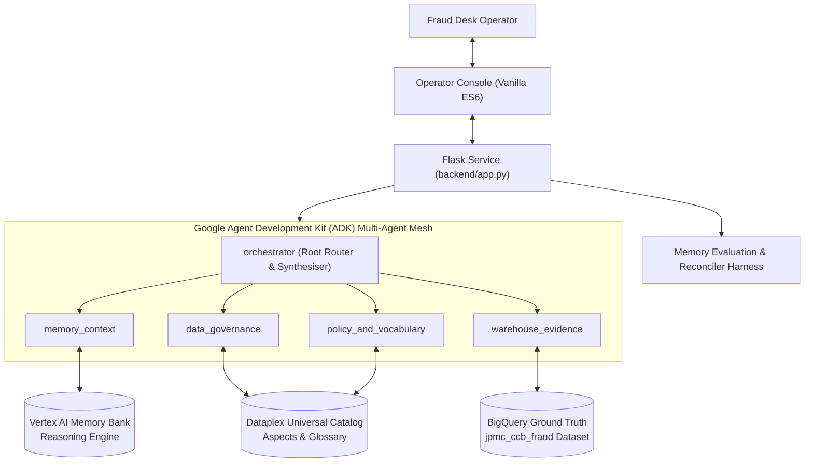

# JPMorgan Chase Consumer Credit: Vertex AI Memory Bank & Data Governance Mesh

[](https://cloud.google.com/vertex-ai)
[](https://google.github.io/agent-development-kit/)
[](https://cloud.google.com/dataplex)
[](https://cloud.google.com/bigquery)
[](tests/)

An enterprise fraud-desk multi-agent platform pairing **Google Cloud Vertex AI Agent Engine Memory Bank**, **Dataplex Universal Catalog**, and **BigQuery Ground Truth** using the **Google Agent Development Kit (ADK)**.

---

## 📑 Table of Contents

1. [Architectural Overview](#1-architectural-overview)
2. [Multi-Agent Topology](#2-multi-agent-topology)
3. [Memory Bank: Capabilities, Mechanics & Experimental Evidence](#3-memory-bank-capabilities-mechanics--experimental-evidence)
4. [Dataplex Universal Catalog: Pre-Read Governance](#4-dataplex-universal-catalog-pre-read-governance)
5. [Warehouse Ground Truth: Reconciling Memory Against Facts](#5-warehouse-ground-truth-reconciling-memory-against-facts)
6. [Side-by-Side Comparison: ADK vs. Direct Implementation](#6-side-by-side-comparison-adk-vs-direct-implementation)
7. [API Specification](#7-api-specification)
8. [Setup & Quickstart Runbook](#8-setup--quickstart-runbook)

---

## 1. Architectural Overview

In retail banking fraud and dispute operations, customer interactions span disparate systems: digital wallets, IVR phone logs, travel notices, and core ledger balances. A common architectural failure in LLM systems is treating LLM memory as an authoritative database, or allowing agents to read sensitive tables without policy validation.

This platform enforces a strict separation of concerns:

- **BigQuery is authoritative for facts**: Account balances, dispute records, card lifecycles, and travel notices reside in BigQuery tables. Ad-hoc SQL is rejected; agents query through audited, parameterised golden queries.
- **Dataplex Universal Catalog is authoritative for policy & vocabulary**: Every table and column read must be pre-authorised against Dataplex governance aspects (`agent_behavior: ALLOW | ALLOW_TO_OWNER_ONLY | REFUSE`). Regulatory definitions are grounded in the Dataplex Business Glossary.
- **Vertex AI Memory Bank is authoritative for customer narrative**: Preserves cross-session conversational context, customer statements, preferences, and commitments. It records what the customer *said*, not what the core banking system *executed*.
- **Google ADK orchestrates the mesh**: Specialized agents delegate through a root orchestrator with auditable tool boundaries.



---

## 2. Multi-Agent Topology

Implemented in [`backend/adk_agents.py`](backend/adk_agents.py) using the Google Agent Development Kit (`google.adk.agents.LlmAgent`) and driven by a real `InMemoryRunner`:

| Agent | Role | Tools Bound | Architectural Responsibility |
|:---|:---|:---|:---|
| **`orchestrator`** | Root Orchestrator | *None directly* | Receives the user question, determines which specialist sub-agents to invoke, and synthesises evidence into a final response. Because it possesses no direct data tools, every factual assertion is traceable to a sub-agent trace. |
| **`memory_context`** | Sub-Agent | `list_memory_topics`, `search_customer_memory`, `list_all_customer_memory` | Read-only access to customer conversational history in Vertex AI Memory Bank. It cannot execute writes during an inquiry turn, eliminating state contamination during inspection. |
| **`data_governance`** | Sub-Agent | `catalog_authorize_table`, `catalog_authorize_column`, `catalog_discover_tables` | Interrogates Dataplex Universal Catalog aspects prior to data access. Validates whether tables or columns are active or deprecated, and enforces owner-only or refusal rules. |
| **`warehouse_evidence`** | Sub-Agent | `list_warehouse_queries`, `run_warehouse_query` | Executes pre-compiled, parameterised BigQuery SQL queries. Ad-hoc SQL strings from the model are blocked at the interface. |
| **`policy_and_vocabulary`** | Sub-Agent | `glossary_lookup`, `glossary_search` | Resolves banking dispute concepts (Regulation E, Regulation Z, chargeback windows, provisional credit) against the official Dataplex Business Glossary. |

---

## 3. Memory Bank: Capabilities, Mechanics & Experimental Evidence

Vertex AI Agent Engine Memory Bank provides semantic memory persistence over reasoning engines. Rather than treating it as a black-box vector database, the codebase includes an evaluation suite in [`backend/memory_eval/`](backend/memory_eval/) that measures its operational behavior.

Full experimental data and methodology are documented in [`docs/MEMORY_BANK_EVIDENCE.md`](docs/MEMORY_BANK_EVIDENCE.md).

### A. Intelligent Writes: Topics Decide What to Write and What to Exclude

Memory Bank does not append raw transcripts. During extraction (`POST {engine}/memories:generate`), topics act as an **inclusion filter**:

- **Custom Fraud Desk Topics**: The engine is configured with seven domain topics (`TRAVEL_STATUS`, `DISPUTE_HISTORY`, `CONTACT_PREFERENCE`, `DEVICE_WALLET_INVENTORY`, `AGENT_COMMITMENTS`, `CARD_LIFECYCLE`, `SPENDING_CONTEXT`).
- **Managed Default Topics**: The platform defaults (`USER_PERSONAL_INFO`, `USER_PREFERENCES`, `KEY_CONVERSATION_DETAILS`, `EXPLICIT_INSTRUCTIONS`).

In a controlled three-arm experiment across identical transcripts and scopes:
- When processing a personal dialogue transcript (`personal_info_only`), an engine with `desk_custom` topics wrote **0 memories** (`done: true` with no response body).
- The exact same transcript under `managed_defaults` extracted **2 memories** (`USER_PERSONAL_INFO`).
- **Finding**: Topics are not tags applied after extraction; they govern whether extraction occurs.

In the `inclusion` benchmark (`mixed_signal_call`, 9 utterances):
- **Durable facts retained**: 4 of 4 (`durable_coverage = 1.0`).
- **Disposable chatter leaked**: 0 (`disposable_leaked_ids = []`).
- **Warehouse balances leaked**: 0 (`warehouse_leaked_ids = []`). The statement balance of "$4,280.50" was discarded because it is volatile ledger data that belongs in BigQuery.

### B. Tenant Boundary: Scope Isolation

- Memory operations are partitioned by `scope` (e.g., `{"customer_id": "CUST00001"}`).
- Queries across differing scopes yield **0 results**.
- Scope matching is exact: adding an unexpected key returns **0 results**. A session-scoped write cannot be retrieved with a customer-level scope.

### C. Fact Consolidation vs. Append Logs

- In an incremental dialogue test, updating an itinerary from "Lisbon in October" to "Lisbon from October 2 to October 11" produced an **`UPDATE`** action, keeping corpus size at 1 rather than creating duplicate fragments.
- An explicit cancellation statement triggered a **`DELETED`** action, leaving the corpus at 0.

### D. Retrieval Precision and Recall

Evaluated across 12 diagnostic probes in [`benchmarks/retrieval_probes.json`](benchmarks/retrieval_probes.json) against the live corpus:

| Metric | k=1 | k=3 | k=5 (Preset Headline) | k=10 |
|:---|:---:|:---:|:---:|:---:|
| **Macro Precision** | 0.5833 | 0.5833 | **0.5000** | 0.2750 |
| **Macro Recall** | 0.2554 | 0.7208 | **0.9589** | 1.0000 |
| **Macro F1** | 0.5241 | 0.6781 | **0.6404** | 0.4315 |
| **Mean Reciprocal Rank (MRR)** | 1.0000 | 0.8500 | **0.7955** | 0.7955 |
| **nDCG** | 0.6364 | 0.7919 | **0.8599** | 0.8599 |

*Note on Precision Ceiling*: In a corpus of 12 memories where queries have an average of ~2.75 relevant items, retrieving $k=5$ yields a maximum theoretical precision of $\frac{2.75}{5} = 0.55$. The measured precision of $0.50$ indicates that nearly all returned items up to the relevant set boundary are true positives.

---

## 4. Dataplex Universal Catalog: Pre-Read Governance

Data governance is enforced via [`backend/knowledge_catalog.py`](backend/knowledge_catalog.py). Prior to querying BigQuery, the system queries Dataplex aspect metadata:

- **Lifecycle Governance**: Tables with `lifecycle-status.status == DEPRECATED` (e.g., `authorizations_deprecated_v1`) trigger a **`REFUSE`** decision with agent guidance directing queries to the active table.
- **Sensitivity Governance**: The `sensitivity-class` aspect defines `agent_behavior` (`ALLOW`, `ALLOW_TO_OWNER_ONLY`, `REFUSE`).
- **Column-Level Overrides**: The system inspects column aspect suffixes (e.g., `sensitivity-class@Schema.pan_full`). A query attempting to read full PANs is intercepted and refused.
- **Business Glossary Grounding**: 45 standardized terms across 5 categories in the `ccb-fraud-disputes` glossary provide verified definitions for dispute handling.

---

## 5. Warehouse Ground Truth: Reconciling Memory Against Facts

Memory Bank records what a customer claimed or requested. Core banking ledgers record transactional facts. [`backend/memory_eval/reconcile.py`](backend/memory_eval/reconcile.py) detects divergences between memory and ledger state:

1. **Travel Notice Discrepancy**: A customer conversational memory asserts travel to **London**. BigQuery `travel_notices` records an active travel window for **Lisbon** with an early return date. The reconciler flags the London assertion as unverified/contradicted.
2. **Disputed Amounts**: Memories quoting conversational figures ("412 euros", "90 euros") are reconciled against authoritative BigQuery dispute records (`DSP00024`, `DSP00025`, `DSP00033`).
3. **Hygiene Rules**: Card suffixes (e.g., "card ending in 4417") and bare quantities are explicitly protected from false numeric contradiction checks against monetary amounts.

---

## 6. Side-by-Side Comparison: ADK vs. Direct Implementation

Implemented in [`backend/custom_agent_comparison.py`](backend/custom_agent_comparison.py) and exposed via `POST /api/agents/run` / UI:

- **Lane A (Google ADK)**: Declarative multi-agent system using `LlmAgent`, sub-agent delegation, and tool schemas.
- **Lane B (Direct / Non-Framework)**: Direct sequential Python calls to `MemoryBankClient.retrieve()`, `CatalogGovernor.search_terms()`, and `GroundTruthReader.run()`, feeding a manually formatted prompt to `genai.Client`.
- **Honest Provenance**:
  - Integration LOC is computed dynamically at runtime using `inspect.getsourcelines()`.
  - Latencies are measured using `time.perf_counter()`.
  - Unreported metrics (e.g. ADK runner internal token counts) render strictly as `n/r` ("not reported") via [`backend/provenance.py`](backend/provenance.py), rather than substituting fabricated estimates.
  - Epistemic parity verifies whether both approaches observed the exact same set of underlying Memory Bank memory IDs.

---

## 7. API Specification

The Flask service in [`backend/app.py`](backend/app.py) provides 21 REST endpoints (and `/` for the operator console):

```
System & Session
  GET  /api/health                     - Probes live Vertex AI, BigQuery, and Dataplex connectivity
  GET  /api/session                    - Active GCP project, engine, dataset, and available customers

Memory Bank Operations
  GET  /api/memory/topics              - Registered engine topics (custom and managed)
  GET  /api/memory/list                - List all stored memories for a customer scope
  POST /api/memory/retrieve            - Similarity search returning distance-ranked memories
  POST /api/memory/generate            - Extract memories from dialogue with intelligent write/exclusion

Dataplex Catalog & Governance
  GET  /api/catalog/overview           - Health, glossary summary, and registered table facets
  GET  /api/catalog/terms              - Search or list business glossary definitions
  GET  /api/catalog/authorize          - Evaluate table or column governance aspects
  GET  /api/catalog/discover           - Discover active replacement tables for deprecated assets

BigQuery Warehouse Evidence
  GET  /api/warehouse/queries          - List audited golden query definitions
  POST /api/warehouse/run              - Execute a parameterised golden query with catalog guardrails

Agent Execution & Interaction
  POST /api/chat                       - Fraud desk agent turnaround with evidence citations
  POST /api/chat/stream                - Server-Sent Events (SSE) streaming chat response
  GET  /api/agents/list                - Topology of the 5-agent ADK mesh
  POST /api/agents/run                 - Execute ADK turn or side-by-side comparison

Evaluation & Verification Harness
  GET  /api/eval/probes                - Diagnostic retrieval evaluation probes
  POST /api/eval/retrieval             - Run precision/recall benchmark across k sweep
  POST /api/eval/write-policy          - Run write inclusion, topic filtering, or scope tests
  GET  /api/eval/reconcile             - Audit memory statements against BigQuery facts
```

---

## 8. Setup & Quickstart Runbook

### Prerequisites

- Python 3.11+
- Google Cloud SDK (`gcloud`) authenticated with access to Vertex AI, BigQuery, and Dataplex
- Standard Linux/macOS environment

### Environment Configuration

Copy `.env.example` to `.env` and fill in your GCP resource identifiers:

```bash
cp .env.example .env
```

```ini
# .env
GOOGLE_GENAI_USE_VERTEXAI=true
GOOGLE_CLOUD_PROJECT=your-gcp-project-id
GOOGLE_CLOUD_PROJECT_NUMBER=000000000000
GOOGLE_CLOUD_LOCATION=us-central1
VERTEX_AGENT_ENGINE_ID=000000000000000000
BIGQUERY_DATASET=your_dataset_id
DATAPLEX_GLOSSARY=your-glossary-id
PORT=5060
```

> [!NOTE]
> `backend/config.py` validates all required environment variables on startup. Missing configurations raise a descriptive `ConfigurationError` rather than falling back to mock defaults.

### Running Tests Offline

The test suite runs 100% offline without network calls or GCP credentials:

```bash
PYTHONPATH=. pytest tests/ -v
```

All 49 unit and contract tests pass offline in < 3 seconds.

### Running the Evaluation Suite

To evaluate Memory Bank precision, recall, topic filtering, and ground-truth reconciliation:

```bash
set -a && . ./.env && set +a

# Run all diagnostic stages
PYTHONPATH=. python3 -m backend.memory_eval.runner --json-out /tmp/eval_results.json

# Run individual stages
PYTHONPATH=. python3 -m backend.memory_eval.runner --only retrieval
PYTHONPATH=. python3 -m backend.memory_eval.runner --only inclusion
PYTHONPATH=. python3 -m backend.memory_eval.runner --only topics
PYTHONPATH=. python3 -m backend.memory_eval.runner --only reconcile
```

### Launching the Web Operator Console

```bash
set -a && . ./.env && set +a
PYTHONPATH=. python3 backend/app.py
```

Open `http://localhost:5060` in your browser to access the Fraud Desk Console.
