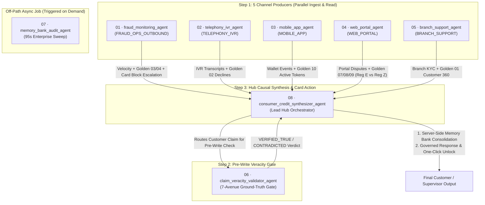

# The 8 CCB Fraud & Disputes Desk Agents & End-to-End Execution Flow

This document specifies:
1. **The End-to-End Execution Flow (`A -> B -> C -> Output`)** across the 8 agents — where a run starts, which agent runs when, where each output is routed, and how a run ends.
2. **All 8 Agents (`01` through `08`)** defined in `backend/adk_agents.py` (`create_consumer_credit_synthesizer_agent` at L1685 and `list_all_agents` at L1885).

---

## 1. End-to-End Agent Flow (`Start -> Routing -> Final Output`)

Every spoke (`01`–`07`) is constructed with `disallow_transfer_to_parent=True` and `disallow_transfer_to_peers=True` (`backend/adk_agents.py:L1675`). That means **spokes never talk directly to each other (`01` never calls `02`)** — every spoke reports its output exclusively to the central hub **`08 · consumer_credit_synthesizer_agent`**.

### Flow A: Full Workbench Turn (`Replay run →` or `Ask response`)
When the operator clicks **`Replay run →`** or sends a question in **`Ask response`** (`POST /api/chat` + `GET /api/chat/stream` in `backend/app.py`):

1. **Stage 1 (`phase.0_channels`) — 5 Channel Producers (`01`–`05`) Run in Parallel**:
   - **Starts at**: `01_fraud_monitoring_agent`, `02_telephony_ivr_agent`, `03_mobile_app_agent`, `04_web_portal_agent`, and `05_branch_support_agent`.
   - **What happens**: Each spoke queries Vertex AI Memory Bank (`sessions.list`, `events.list`, `memories.retrieve`) for its own channel (`FRAUD_OPS_OUTBOUND`, `TELEPHONY_IVR`, `MOBILE_APP`, `WEB_PORTAL`, `BRANCH_SUPPORT`).
   - **Where output goes**: All 5 channel snapshots are handed to `08_consumer_credit_synthesizer_agent`.
2. **Stage 2 (`phase.1_evidence` & `phase.2_glossary`) — Domain Golden Queries & Dataplex Glossary**:
   - **`04_web_portal_agent`** runs `golden_07_open_disputes_for_customer` (`DSP00033` Debit Reg E + `DSP00034` Credit Reg Z) and looks up `regulation-e`, `regulation-z`, and `provisional-credit` in Dataplex Business Glossary.
   - **`03_mobile_app_agent`** runs `golden_10_wallet_tokens_active_on_card` to check if an Apple Pay / Google Pay token (`token_id`) is still active on the restricted card.
   - **`05_branch_support_agent`** runs `golden_01_customer_360_snapshot` to verify customer identity, segment, and standing instructions.
   - **Where output goes**: Routed to `08_consumer_credit_synthesizer_agent` and `06_claim_veracity_validator_agent`.
3. **Stage 3 (`phase.3_veracity`) — Pre-Write Claim Audit (`06 -> 08`)**:
   - **Triggered next**: `06_claim_veracity_validator_agent` (`ClaimVeracityValidatorAgent` in `backend/veracity_and_audit.py`).
   - **What happens**: Before any new claim from the turn is written to Memory Bank, `06` cross-checks the claim against BigQuery Golden Queries (`01`, `02`, `03`, `04`, `07`) and scoped Memory Bank facts (`veracity.authorize_sources` $\to$ `veracity.avenue.*` $\to$ `veracity.gemini_evaluate`).
   - **Where output goes**: Returns `ClaimVeracityEvaluation` (`VERIFIED_TRUE` or `CONTRADICTED_BY_TELEMETRY`) to `08_consumer_credit_synthesizer_agent`.
4. **Stage 4 (`phase.4_memory_write` & `/api/chat/stream`) — Consolidation & Final Synthesis (`08`)**:
   - **Ends at**: `08_consumer_credit_synthesizer_agent`.
   - **What happens**:
     1. Hands the verified turn to Vertex AI Memory Bank (`memories:generate`, `wait=False`) for server-side consolidation.
     2. Streams the final causal timeline and governed answer (`onAgentThought` $\to$ `onMemoryBankAccess` $\to$ `onAgentSynthesis` $\to$ `onUiComponentDelivery`) to the UI and updates the Supervisor Card Control panel (`▶ Unlock card` / `Keep restricted ×`).

---

### Flow B: Single-Agent Live Run (`▶ Run Agent Live` on any Agent Card Popup)
When you click any agent in the `Pipeline` column and click **`▶ Run Agent Live`** (`POST /api/agents/<agent_key>/run`):

1. **Starts at**: `google.adk.runners.InMemoryRunner` (`run_adk_agent_live()` in `backend/adk_agents.py:L2111`) instantiates **only** that selected `LlmAgent` (for example, `01_fraud_monitoring_agent`).
2. **Internal Tool Sequence for `01_fraud_monitoring_agent`**:
   - `query_fraud_velocity_alerts(customer_id="CUST00001")` $\to$ reads `FRAUD_OPS_OUTBOUND` sessions from Memory Bank.
   - `golden_03_suspicious_activity_on_card_window(card_id="CARD00002")` $\to$ checks Dataplex (`authorizations` ACTIVE, refuses `authorizations_deprecated_v1` & `cards.pan_full`) and queries BigQuery (`28` high-risk rows).
   - `golden_04_geo_impossible_travel(card_id="CARD00002")` $\to$ queries BigQuery (`30` impossible-travel pairs, e.g. Lisbon PT $\to$ San Jose US at `273,713 km/h`).
   - `execute_fraud_card_control_or_escalate(action="CARD_BLOCK_AND_ESCALATE")` $\to$ writes a new `FRAUD_OPS_OUTBOUND` escalation event into Memory Bank and **escalates `01 -> 08` (`consumer_credit_synthesizer_agent`)**.
3. **Why `02`, `03`, `04`, `05` Previously Appeared in the Trace (and How It Was Fixed)**:
   - Previously, `POST /api/agents/<agent_key>/run` called `produce_all_channels_snapshot()` *inside* the same `obs.run_context(kind="chat")` block after `InMemoryRunner` finished, which ran `channel.produce` for all 5 channels under the same `run_id`.
   - **Fixed in `backend/app.py:L341` and `backend/obs.py:L382`**:
     1. Worker threads inside `InMemoryRunner` now inherit the active `run_id` (`_ACTIVE_RUN_ID_FALLBACK` in `backend/obs.py`) so all child tool calls (`golden_query.03`, `golden_query.04`, `fraud.card_control_or_escalate`) record under the agent's `run_id`.
     2. `produce_all_channels_snapshot()` now runs in a separate `kind="probe"` context outside the agent's `run_id`.
     3. Running `01_fraud_monitoring_agent` now lights up **only `01_fraud_monitoring_agent` and its `08_consumer_credit_synthesizer_agent` escalation receiver (`2 / 8 active`)** — leaving `02`, `03`, `04`, `05`, `06`, `07` idle (`0 spans`).

---

## 2. The 8 Agents — Roles, Scopes, Governance & Tools

### 01 · `fraud_monitoring_agent`
**Fraud Velocity & Geo-Anomaly Specialist (`CHANNEL_PRODUCER · FRAUD_OPS_OUTBOUND`)**
- **Starts / Triggered By**: Parallel Stage 1 channel read (`phase.0_channels`) or `▶ Run Agent Live` (`InMemoryRunner`).
- **Routes Output To**: `08 · consumer_credit_synthesizer_agent` (via `CARD_BLOCK_AND_ESCALATE` in Memory Bank).
- **🧠 Memory Bank Topics Scoped**: `TRAVEL_STATUS` · `CARD_LIFECYCLE` · `SPENDING_CONTEXT`
- **🛡️ Dataplex Catalog Governance**: `authorizations (ACTIVE)` · `agg_merchant_velocity_daily (ACTIVE)` · `authorizations_deprecated_v1 (REFUSE · DEPRECATED)` · `cards.pan_full (REFUSE · PII)` · `authorizations.is_fraud (REFUSE · Triage Label)`
- **🏛️ Authorized BigQuery Golden Queries (`6`)**: `02_recent_authorizations` · `03_suspicious_activity_window` · `04_geo_impossible_travel` · `05_merchant_velocity_spike` · `06_cnp_burst_detection` · `12_fraud_rate_by_mcc`
- **🔧 Bound ADK Tools (`4`)**: `query_fraud_velocity_alerts` · `golden_03_suspicious_activity_on_card_window` · `golden_04_geo_impossible_travel` · `execute_fraud_card_control_or_escalate`

### 02 · `telephony_ivr_agent`
**Contact Center IVR & Inbound Call Specialist (`CHANNEL_PRODUCER · TELEPHONY_IVR`)**
- **Starts / Triggered By**: Parallel Stage 1 channel read or `▶ Run Agent Live`.
- **Routes Output To**: `08 · consumer_credit_synthesizer_agent` and `06 · claim_veracity_validator_agent`.
- **🧠 Memory Bank Topics Scoped**: `STEP_UP_AUTH` · `TRAVEL_STATUS` · `CALL_TRANSCRIPT_FACTS`
- **🛡️ Dataplex Catalog Governance**: `authorizations (ACTIVE)` · `cards (ACTIVE)` · `merchants (ACTIVE)` · `authorizations_deprecated_v1 (REFUSE · DEPRECATED)` · `cards.pan_full (REFUSE · PII)` · `cards.pan_masked (ALLOW_TO_OWNER_ONLY)`
- **🏛️ Authorized BigQuery Golden Queries (`1`)**: `02_recent_authorizations_for_card`
- **🔧 Bound ADK Tools (`2`)**: `query_ivr_call_records` · `golden_02_recent_authorizations_for_card`

### 03 · `mobile_app_agent`
**Mobile Banking & Digital Wallet Token Specialist (`CHANNEL_PRODUCER · MOBILE_APP`)**
- **Starts / Triggered By**: Parallel Stage 1 channel read, Stage 2 token evidence probe (`AV-TOKENS`), or `▶ Run Agent Live`.
- **Routes Output To**: `08 · consumer_credit_synthesizer_agent`.
- **🧠 Memory Bank Topics Scoped**: `DEVICE_WALLET_TOKENS` · `RECURRING_MERCHANT_RULES` · `MOBILE_GEO_CHECKIN`
- **🛡️ Dataplex Catalog Governance**: `wallet_tokens (ACTIVE)` · `devices (ACTIVE)` · `cards (ACTIVE)` · `cards.pan_full (REFUSE · PII)` · `cards.pan_masked (ALLOW_TO_OWNER_ONLY)`
- **🏛️ Authorized BigQuery Golden Queries (`2`)**: `10_wallet_tokens_active_on_card` · `11_dispute_event_timeline`
- **🔧 Bound ADK Tools (`2`)**: `query_mobile_wallet_events` · `golden_10_wallet_tokens_active_on_card`

### 04 · `web_portal_agent`
**Online Banking & Statutory Dispute Policy Specialist (`CHANNEL_PRODUCER · WEB_PORTAL`)**
- **Starts / Triggered By**: Parallel Stage 1 channel read, Stage 2 dispute ledger + Dataplex glossary lookup (`Reg E` vs `Reg Z`), or `▶ Run Agent Live`.
- **Routes Output To**: `08 · consumer_credit_synthesizer_agent` and `06 · claim_veracity_validator_agent`.
- **🧠 Memory Bank Topics Scoped**: `OPEN_DISPUTE_CLAIMS` · `HOTEL_COURIER_ADDRESS` · `STANDING_INSTRUCTIONS`
- **🛡️ Dataplex Catalog Governance**: `disputes (ACTIVE)` · `accounts (ACTIVE)` · `cards (ACTIVE)` · `glossary:regulation-e (VERIFIED)` · `glossary:regulation-z (VERIFIED)` · `cards.pan_full (REFUSE · PII)`
- **🏛️ Authorized BigQuery Golden Queries (`3`)**: `07_open_disputes_for_customer` · `08_dispute_filing_window_check` · `09_provisional_credit_due`
- **🔧 Bound ADK Tools (`2`)**: `query_web_portal_activity` · `golden_07_open_disputes_for_customer`

### 05 · `branch_support_agent`
**In-Branch Banker & Identity Verification Specialist (`CHANNEL_PRODUCER · BRANCH_SUPPORT`)**
- **Starts / Triggered By**: Parallel Stage 1 channel read, Stage 2 Customer 360 check, or `▶ Run Agent Live`.
- **Routes Output To**: `08 · consumer_credit_synthesizer_agent` and `06 · claim_veracity_validator_agent`.
- **🧠 Memory Bank Topics Scoped**: `IN_PERSON_KYC` · `RELATIONSHIP_TENURE` · `BRANCH_CASE_NOTES`
- **🛡️ Dataplex Catalog Governance**: `v_customer_360 (ACTIVE)` · `customers (ACTIVE)` · `accounts (ACTIVE)` · `cards (ACTIVE)` · `customers.ssn_last4 (REFUSE · PII)` · `customers.customer_id (ALLOW)`
- **🏛️ Authorized BigQuery Golden Queries (`2`)**: `01_customer_360_snapshot` · `11_dispute_event_timeline`
- **🔧 Bound ADK Tools (`2`)**: `query_branch_teller_interactions` · `golden_01_customer_360_snapshot`

### 06 · `claim_veracity_validator_agent`
**Pre-Write Claim Veracity Gatekeeper (`PRE_WRITE_VALIDATOR`)**
- **Starts / Triggered By**: Stage 3 (`phase.3_veracity`) after channel & BigQuery evidence is gathered, or `▶ Run Agent Live`.
- **Routes Output To**: `08 · consumer_credit_synthesizer_agent` (gates whether `08` writes the session to Memory Bank).
- **🧠 Memory Bank Topics Scoped**: `TRAVEL_STATUS` · `CARD_LIFECYCLE` · `OPEN_DISPUTE_CLAIMS` · `STEP_UP_AUTH`
- **🛡️ Dataplex Catalog Governance**: `v_customer_360 (ACTIVE)` · `authorizations (ACTIVE)` · `disputes (ACTIVE)` · `authorizations_deprecated_v1 (REFUSE · DEPRECATED)` · `customers.ssn_last4 (REFUSE · PII)` · `cards.pan_full (REFUSE · PII)`
- **🏛️ Authorized BigQuery Golden Queries (`5`)**: `01_customer_360_snapshot` · `02_recent_authorizations_for_card` · `03_suspicious_activity_on_card_window` · `04_geo_impossible_travel` · `07_open_disputes_for_customer`
- **🔧 Bound ADK Tools (`1`)**: `validate_and_record_customer_claim`

### 07 · `memory_bank_audit_agent`
**Enterprise Memory Bank Consolidated Sweep Auditor (`CONSOLIDATED_AUDITOR · ASYNC JOB`)**
- **Starts / Triggered By**: Operator button **`▶ Run 95s audit sweep (async)`** (`POST /api/audit-sweep/trigger`) or `▶ Run Agent Live`.
- **Routes Output To**: Async Audit Status Panel (`#auditSweepOutput`).
- **🧠 Memory Bank Topics Scoped**: `ALL_TOPICS (Enterprise Audit Scope: CUST00001 .. CUST00010)`
- **🛡️ Dataplex Catalog Governance**: `v_customer_360 (ACTIVE)` · `authorizations (ACTIVE)` · `disputes (ACTIVE)` · `customers.ssn_last4 (REFUSE · PII)` · `cards.pan_full (REFUSE · PII)`
- **🏛️ Authorized BigQuery Golden Queries (`2`)**: `01_customer_360_snapshot` · `04_geo_impossible_travel`
- **🔧 Bound ADK Tools (`1`)**: `run_consolidated_memory_audit_sweep`

### 08 · `consumer_credit_synthesizer_agent`
**Lead Synthesizer & Hub Orchestrator (`LEAD_SYNTHESIZER · CORE_BANKING`)**
- **Starts / Triggered By**: Receives all spoke outputs (`01`–`06`) in Stage 4 (`phase.4_memory_write` + `/api/chat/stream`), Supervisor Card Control (`▶ Unlock card`), or `▶ Run Agent Live`.
- **Routes Output To**: Customer / Operator Governed Response UI (`#askAnswerBody`), Supervisor Card Control (`#oversightCardStatusBadge`), and Vertex AI Memory Bank (`memories:generate`).
- **🧠 Memory Bank Topics Scoped**: `TRAVEL_STATUS` · `CARD_LIFECYCLE` · `OPEN_DISPUTE_CLAIMS` · `DEVICE_WALLET_TOKENS` · `STANDING_INSTRUCTIONS` · `STEP_UP_AUTH`
- **🛡️ Dataplex Catalog Governance**: `v_customer_360 (ACTIVE)` · `disputes (ACTIVE)` · `wallet_tokens (ACTIVE)` · `dispute_events (ACTIVE)` · `glossary:regulation-e (VERIFIED)` · `glossary:regulation-z (VERIFIED)` · `customers.ssn_last4 (REFUSE · PII)` · `cards.pan_full (REFUSE · PII)`
- **🏛️ Authorized BigQuery Golden Queries (`6`)**: `01_customer_360_snapshot` · `07_open_disputes_for_customer` · `08_dispute_filing_window_check` · `09_provisional_credit_due` · `10_wallet_tokens_active_on_card` · `11_dispute_event_timeline`
- **🔧 Bound ADK Tools (`3` direct + `7` sub-agent spokes)**: `list_memory_topics_tool` · `read_customer_memory_bank` · `execute_one_click_card_unlock`
