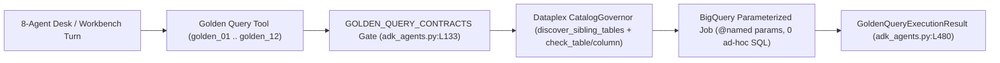

# Golden Queries & Runtime Governance Architecture

> **Note**: This document is our expanded architecture guide for the 8-agent CCB Fraud Desk (`backend/adk_agents.py`). The original kit index at `jpmc_fraud_demo_kit/jpmc_fraud_demo_kit/queries/golden/INDEX.md` is kept untouched.

---

## 1. Your Understanding of `GOLDEN_QUERY_CONTRACTS` (`backend/adk_agents.py:L133`)

Your understanding is **100% right**. `GOLDEN_QUERY_CONTRACTS` (`backend/adk_agents.py:L133`) and `execute_golden_query_contract()` (`backend/adk_agents.py:L331`) do two jobs at the same time:

1. **Runtime Authorization & Governance Gate**:
   - No agent can write its own raw SQL (`ad_hoc_sql = 0`).
   - Every query (`01` through `12`) lists the exact `authorized_agents` allowed to call it, the `required_parameters` (bound via `@named` BigQuery parameters), the `governed_tables`, and the `governed_columns_checked`.
   - Before BigQuery runs a single line of SQL, `execute_golden_query_contract()` asks Dataplex (`CatalogGovernor`) to inspect the target table, discover any sibling tables (`discover_sibling_tables`), and check sensitive columns — logging voluntary refusals for deprecated tables (`authorizations_deprecated_v1`) and restricted PII columns (`customers.ssn_last4`, `cards.pan_full`).

2. **Maximum Right-Sized Context in One Call**:
   - Instead of making an LLM guess how to join 6 banking tables over multiple turns, each `.sql` file pre-joins the exact tables and computes the domain math right in BigQuery (for example, great-circle travel speed in `04_geo_impossible_travel.sql` or business-day Reg E vs Reg Z deadlines in `08_dispute_filing_window_check.sql`).
   - One tool call returns a complete, clean, redacted record set with everything that specific agent needs to finish its task.

---

## 2. Where This Layer Sits in the Stack

- **Layer**: It sits directly between **Agent Tool Invocation** and **BigQuery / Dataplex**.
- **Entry Point**: Every agent tool (`golden_01_customer_360_snapshot` .. `golden_12_fraud_rate_by_merchant_category` and the 8-agent wrappers at `backend/adk_agents.py:L959-L1110`) calls `execute_golden_query_contract()` (`backend/adk_agents.py:L331`).

---

## 3. All 12 Golden Queries & Which Agents Use Them

| ID | SQL File | Plain-English Purpose | Contract Role (`authorized_agents`) | 8-Agent Hub-and-Spoke Caller (`backend/adk_agents.py`) | Tables Joined & Checked |
| :--- | :--- | :--- | :--- | :--- | :--- |
| **01** | `01_customer_360_snapshot.sql` | Who is this customer, what accounts/cards do they hold, and what do their last 90 days look like? | `ORCHESTRATOR`, `IDENTITY_CONTEXT` | `branch_support_agent` (`05`), `claim_veracity_validator_agent` (`06`), `consumer_credit_synthesizer_agent` (`08`) | `v_customer_360`, `customers`, `accounts`, `cards` *(refuses `customers.ssn_last4`)* |
| **02** | `02_recent_authorizations_for_card.sql` | What are the most recent charges (approved or declined) on this card? | `FRAUD_TRIAGE` | `telephony_ivr_agent` (`02`), `claim_veracity_validator_agent` (`06`) | `authorizations`, `cards`, `merchants` *(refuses `cards.pan_full` & `authorizations_deprecated_v1`)* |
| **03** | `03_suspicious_activity_on_card_window.sql` | Which charges in this time window have high risk scores or velocity flags (without peeking at `is_fraud`)? | `FRAUD_TRIAGE` | `fraud_monitoring_agent` (`01`), `claim_veracity_validator_agent` (`06`) | `authorizations`, `cards`, `merchants` |
| **04** | `04_geo_impossible_travel.sql` | Was this card used in two cities too far apart to travel between in the elapsed time (e.g., Lisbon vs NYC/London)? | `FRAUD_TRIAGE` | `fraud_monitoring_agent` (`01`), `claim_veracity_validator_agent` (`06`) | `authorizations`, `merchants` *(computes km distance & required km/h)* |
| **05** | `05_merchant_velocity_spike.sql` | Did a specific merchant have an abnormal spike in volume or fraud rate on a given day? | `FRAUD_TRIAGE` | `fraud_monitoring_agent` (`01`) | `agg_merchant_velocity_daily`, `merchants` |
| **06** | `06_cnp_burst_detection.sql` | Did someone fire a rapid burst of online (card-not-present) charges at this card within seconds? | `FRAUD_TRIAGE` | `fraud_monitoring_agent` (`01`) | `authorizations`, `merchants` |
| **07** | `07_open_disputes_for_customer.sql` | What open disputes does this customer already have across debit (Reg E) and credit (Reg Z)? | `ORCHESTRATOR`, `POLICY_COMPLIANCE` | `web_portal_agent` (`04`), `claim_veracity_validator_agent` (`06`), `consumer_credit_synthesizer_agent` (`08`) | `disputes`, `cards`, `accounts` |
| **08** | `08_dispute_filing_window_check.sql` | Was this dispute filed on time, which rulebook (`Reg E` vs `Reg Z`) applies, and what are the exact statutory deadlines? | `POLICY_COMPLIANCE` | `web_portal_agent` (`04`), `consumer_credit_synthesizer_agent` (`08`) | `disputes`, `accounts`, `cards`, `authorizations` |
| **09** | `09_provisional_credit_due.sql` | Which **Regulation E (debit)** disputes owe the customer provisional credit, and when does the 10-business-day clock expire? | `POLICY_COMPLIANCE` | `web_portal_agent` (`04`), `consumer_credit_synthesizer_agent` (`08`) | `disputes`, `accounts` |
| **10** | `10_wallet_tokens_active_on_card.sql` | Which Apple Pay / Google Pay phones and watches still hold an active token able to spend on this card even after physical card lock? | `RESOLUTION_ACTIONS` | `mobile_app_agent` (`03`), `consumer_credit_synthesizer_agent` (`08`) | `wallet_tokens`, `devices`, `cards` |
| **11** | `11_dispute_event_timeline.sql` | What is the complete chronological audit trail of actions taken on this dispute? | `RESOLUTION_ACTIONS`, `MEMORY_WRITER` | `branch_support_agent` (`05`), `consumer_credit_synthesizer_agent` (`08`) | `dispute_events`, `disputes` |
| **12** | `12_fraud_rate_by_merchant_category.sql` | Portfolio-wide: which merchant categories (MCCs) have the highest confirmed loss rates? | `FRAUD_TRIAGE` | `fraud_monitoring_agent` (`01`) | `authorizations`, `merchants` |

---

## 4. What Happens Without This Layer?

If agents are allowed to generate raw SQL against `jpmc_ccb_fraud` instead of going through `GOLDEN_QUERY_CONTRACTS`:

1. **Regulatory Mistakes (Reg E vs Reg Z)**:
   - In our Lisbon stolen-wallet scenario (`CUST00001`), the customer lost one debit card (`DSP00033` $\to$ **Regulation E**, provisional credit owed within 10 business days) and one credit card (`DSP00034` $\to$ **Regulation Z**, **no provisional credit exists**; instead payment is withheld).
   - An LLM writing ad-hoc SQL against `disputes` sees a null `provisional_credit_date` on the credit card and tells the customer their credit card provisional credit is "delayed" or promises one — a direct compliance violation. Queries `08` and `09` encode the statutory rulebook separation directly in SQL.
2. **Reading Deprecated Tables (`authorizations_deprecated_v1`)**:
   - The dataset contains a stale twin table (`authorizations_deprecated_v1`). Without `discover_sibling_tables()` + Dataplex lifecycle aspect checks, an agent can query the deprecated table and act on stale transaction statuses.
3. **Exposing Restricted PII (`ssn_last4` and `pan_full`)**:
   - Raw `SELECT * FROM customers` or `SELECT * FROM cards` pulls `ssn_last4` and unmasked `pan_full` into the LLM context window and logs. Our contracts never select those columns and log explicit Dataplex `ALLOW_TO_OWNER_ONLY` / `DENY` verdicts.
4. **Cheating on Live Triage (`authorizations.is_fraud`)**:
   - `authorizations.is_fraud` is the post-hoc evaluation label. If a triage agent writes `WHERE is_fraud = TRUE`, it is reading the answer key instead of scoring velocity, risk, and geo distance (Queries `03` and `04`).

---

## 5. Value Proposition Summary

- **Zero SQL Hallucination (`ad_hoc_sql = 0`)**: Every BigQuery execution is a reviewed `.sql` contract with `@named` parameters.
- **Role-Scoped Least Privilege**: Each agent only sees the tools and tables required for its channel/role.
- **Automatic Dataplex Proof on Every Call**: Every query produces an auditable record (`GoldenQueryExecutionResult`) showing the table verdict, sibling tables refused, columns refused, BigQuery `job_id`, and rows returned.
